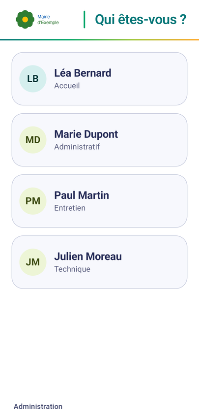
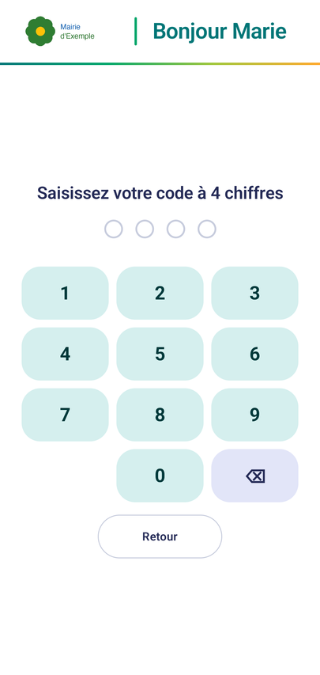
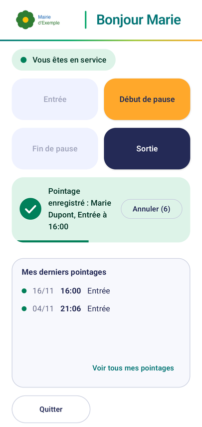
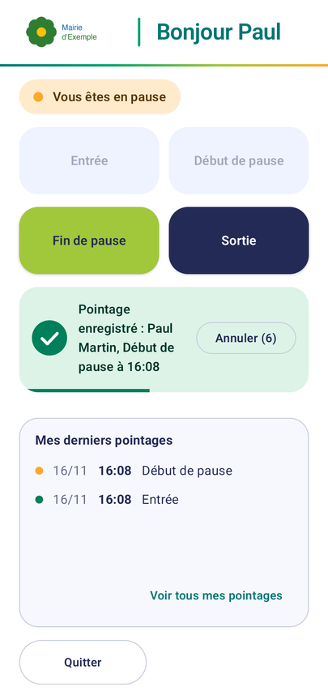
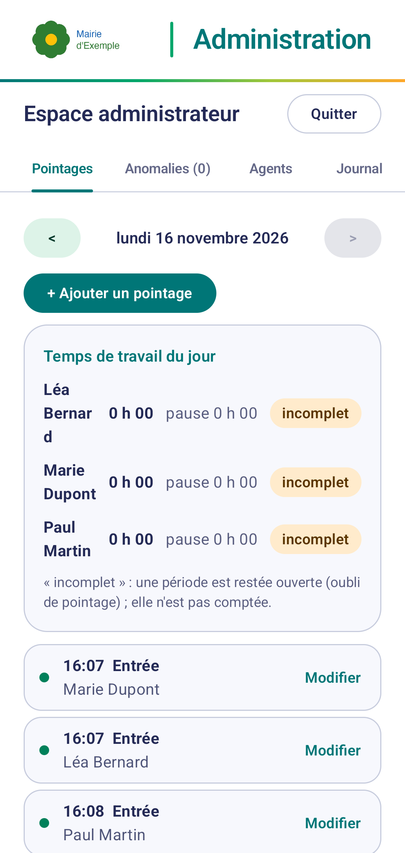
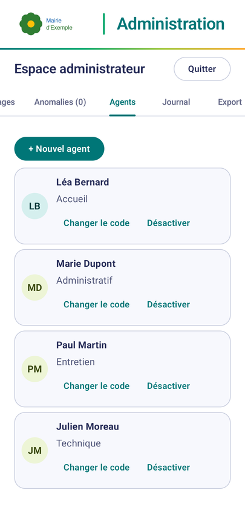
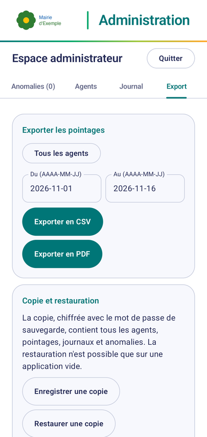

# Badgeuse

Application Android de **pointage du personnel d'une mairie**, pensée pour tourner sur une tablette en **mode kiosque** à l'accueil : chaque agent s'identifie avec un code à 4 chiffres et enregistre son arrivée, sa pause ou son départ.

> Les captures ci-dessous utilisent des **données fictives** (agents « Marie Dupont », « Paul Martin »… et « Mairie d'Exemple-sur-Loire »).

## Captures d'écran

### Côté agent

| Choix de l'agent | Saisie du code | Pointage enregistré | En pause |
|:--:|:--:|:--:|:--:|
|  |  |  |  |

### Côté administrateur

| Pointages du jour | Gestion des agents | Export et sauvegarde |
|:--:|:--:|:--:|
|  |  |  |

## Fonctionnalités

- **Pointage** : entrée, début de pause, fin de pause, sortie, avec annulation possible quelques secondes après le pointage.
- **Code à 4 chiffres** par agent, stocké haché (PBKDF2) ; blocage après plusieurs erreurs.
- **Espace administrateur** protégé par mot de passe : correction des pointages, gestion des agents, journal des modifications en lecture seule, code de secours.
- **Détection des oublis de pointage** (tâche planifiée) et liste des anomalies à traiter.
- **Calcul du temps de travail** quotidien, pauses déduites.
- **Export CSV et PDF** des pointages sur une période.
- **Sauvegarde chiffrée**, enregistrée sur la tablette ou envoyée par e-mail (SMTP) de façon planifiée ; restauration sur une application vide.
- **Purge** des anciens pointages de la tablette, uniquement s'ils ont déjà été envoyés par e-mail.
- **Mode kiosque** : l'application verrouille la tablette (Device Owner).

## Technique

- Kotlin, interface en **Jetpack Compose** (Material 3)
- **Room** (SQLite) pour les données, **WorkManager** pour les tâches planifiées
- JavaMail (Android) pour l'envoi des sauvegardes
- Android 8.0 minimum (`minSdk 26`)
- Code organisé en couches : `domaine` (règles métier, testées en JVM), `donnees`, `ui`, `viewmodel`, `taches`, `export`, `kiosque`

## Compiler et tester

Prérequis : Android Studio (JDK fourni) et le SDK Android 37.

```bash
export JAVA_HOME="/Applications/Android Studio.app/Contents/jbr/Contents/Home"   # macOS
./gradlew assembleDebug        # compile la version de développement
./gradlew test                 # tests unitaires (JVM)
./gradlew connectedAndroidTest # tests instrumentés (émulateur ou appareil requis)
```

Dans une version **debug**, quatre agents fictifs (code `1234`) sont créés au premier lancement pour essayer l'application. Cela n'arrive jamais en version release.

La procédure d'installation en mode kiosque est décrite dans [INSTALLATION.md](INSTALLATION.md).

## Licence

Le code est publié pour être **lu et utilisé tel quel**, mais **non modifié** : voir [LICENSE](LICENSE). Ce n'est pas une licence open source. Pour toute autre utilisation, contactez l'auteur : [Hugollbs](https://github.com/Hugollbs).
